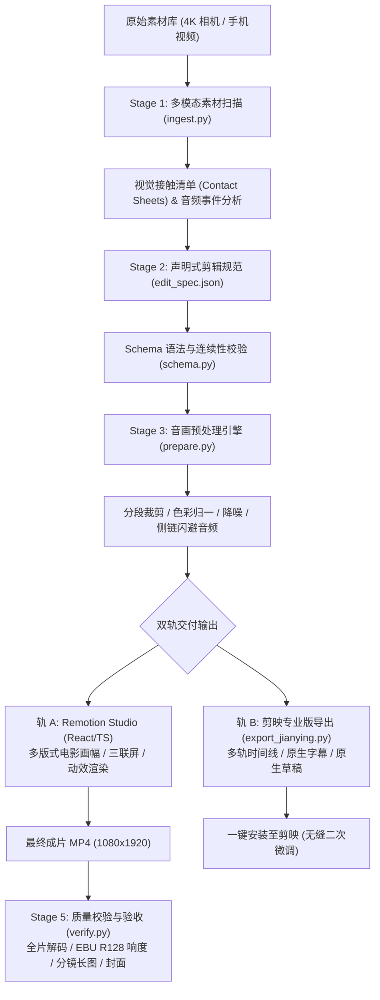

# CutCut: 智能化短视频剪辑流水线与工程脚手架

CutCut 是一个面向短视频平台（抖音 / 小红书 / 视频号）的 AI 智能剪辑全流程系统。它将多机位与手机拍摄的原始大素材（4K S-Log/BT.709、横竖混排），通过多模态素材分析、声明式剪辑描述规范（`EditSpec`）、高保真音视频预处理、代码化视觉渲染引擎（Remotion）与剪映专业版（Jianying Pro）无损草稿导出，实现工业级的短视频敏捷制作流水线。

---

## 🌟 核心特性与架构



### 1. 多模态素材扫描 (Multimodal Ingest)
- 自动提取视频元数据、旋转朝向（Orientation/Rotate tag）自动识别。
- 以 1 秒为步长提取特征帧，计算拉普拉斯清晰度打分（`S:xx`），生成高密度视觉接触清单（Contact Sheets）。
- 分析音频分贝均方根（RMS）与高频频谱跳变，自动打标物理敲击互动事件（`[CRISP]` 键盘敲击声、宠物叫声等）。

### 2. 声明式剪辑语法 (Declarative `EditSpec`)
- 采用强类型结构定义分镜结构、景别、构图版式（`cinema_frame`, `triptych`, `split_2`, `full_bleed`）、运镜缩放（Ken Burns）、音频增益与侧链闪避（Ducking envelope）。
- 内置防跳剪（Jump Cut）与时间回退校验，确保叙事节奏合乎短视频平台播放逻辑。

### 3. 音画一体预处理 (Audio-Visual Normalization)
- 色彩空间归一化至 `bt709`，修复手机元数据旋转导致的黑边问题。
- 环境底噪过滤（高通滤波 + FFT 频域降噪），提取高保真环境音。
- 动态侧链压缩（Sidechain Ducking）：人声/宠物互动时刻自动压低配乐，达到 `-16.5 LUFS` 平台推荐广播级响度。

### 4. 极致双轨交付 (Dual Export)
- **Remotion MP4**: 基于 React + TypeScript 组件化构建高质感动态字幕、多屏拼贴与动效，无头渲染输出最终成片。
- **剪映专业版原生草稿 (Jianying Pro Native Draft)**: 生成兼容 macOS 剪映专业版 11.4+ 的原生草稿工程文件（`draft_info.json`），视频、配乐、环境声多轨分离，字幕转为剪映原生矢量文字，支持一键安装并打开剪映进行个性化微调。

### 5. 自动化质量验收 (QA Verification)
- 完整解码测试保证无花屏、坏帧。
- 自动化生成竖屏分镜九宫格长图与高点击率视频封面。

---

## 📁 仓库目录结构

```text
cutcut/
├── pipeline/                     # Python AI 剪辑核心流水线引擎 (Core Engine)
│   ├── __init__.py
│   ├── cli.py                    # 统一命令行接口 (CLI)
│   ├── director.py               # AI 导演分镜与多模态叙事编排
│   ├── ingest.py                 # 素材扫描与特征提取
│   ├── prepare.py                # 媒体切片与音频侧链处理
│   ├── schema.py                 # EditSpec 语法校验器
│   ├── verify.py                 # 质检与封面提取器
│   └── export_jianying.py        # 可选剪映草稿协议导出器
├── studio/                       # Remotion 视频构图渲染引擎 (React 18 + TS)
│   ├── src/
│   │   ├── layouts/              # 三联屏 / 电影遮幅 / 分屏渲染组件
│   │   └── components/           # 运镜缩放 (Ken Burns) 与动态字幕组件
│   └── remotion.config.ts
├── projects/                     # 剪辑工程目录 (纯结构配置 JSON，无大文件)
│   ├── pet-douyin-v01/           # Codex 初版粗剪归档
│   └── pet-douyin-v02/           # 方案 B 电影感实战工程 (edit_spec.json, catalog.json)
├── data/                         # 素材中心 (全局被 .gitignore 排除大文件)
│   └── raw/                      # 原始多机位 4K/手机拍摄大素材
│       └── desk_setup/           # 桌搭主题拍摄素材
├── docs/                         # 统一文档与调研中心
│   ├── research/                 # 剪辑方法论、平台运营指南与草稿协议逆向
│   └── reviews/                  # 评测与对比复盘 (v01 vs v02 对比报告)
├── assets/
│   └── bgm/                      # 授权背景音乐库 (CC BY 4.0 Lo-Fi / Classical)
├── requirements.txt              # 跨平台 Python 核心依赖清单
└── .gitignore                    # 精准排除媒体大文件与运行时缓存
```

### 🧭 目录职责与输入/输出流向说明

新用户或协作者拿到项目后，只需关注以下三个核心目录：

| 目录路径 | 角色与类型 | 协作说明 | Git 追踪情况 |
| :--- | :--- | :--- | :--- |
| [`data/raw/<主题>/`](data/README.md) | **【输入】原始视频素材库** | 用户放入相机/手机原始实拍视频的地方（支持建多个子文件夹） | ❌ 视频大文件自动忽略（保留文件夹结构说明） |
| [`projects/<工程>/`](projects/README.md) | **【输出/配置】剪辑项目中心** | 记录剪辑分镜配置（`edit_spec.json`）；成片 MP4 会在此生成 | ✅ 只追踪描述 JSON；❌ 自动忽略成片 MP4 与切片 |
| [`pipeline/`](pipeline/README.md) | **【引擎】Python 流水线核心** | 素材扫描、AI 导演编排、音频降噪、侧链闪避与质检工具 | ✅ 纯代码，完整追踪 |
| [`studio/`](studio/README.md) | **【引擎】Remotion 视觉组件** | React + TypeScript 电影级排版与运镜组件，支持浏览器实时预览 | ✅ 纯代码，完整追踪 |
| [`assets/bgm/`](assets/bgm/README.md) | **【资产】公共伴奏曲库** | 内置 CC BY 4.0 免版税音乐，渲染时提供伴奏底色 | ✅ 预置免版权伴奏与许可说明 |
| [`docs/`](docs/) | **【知识】调研与复盘库** | 爆款短视频模型、平台剪辑技巧与 v01/v02 对比评测文档 | ✅ 纯文档 Markdown 完整追踪 |

---

## 🚀 快速上手 (Quickstart)

### 环境依赖
- **macOS** 或 **Windows** / **Linux**
- **Python**: `>= 3.9`
- **Node.js**: `>= 18.0.0`
- **FFmpeg**: `>= 6.0` (`ffmpeg` 与 `ffprobe` 需在系统 `PATH` 中)

### 安装依赖

```bash
# 1. 安装 Python 核心依赖
pip install -r requirements.txt

# 2. 安装 Remotion Studio 渲染依赖
cd studio
npm install
cd ..
```

### 运行流水线

#### ⚡ 方式一：一键全自动 AI 剪辑 (无人值守闭环)
只需提供原始素材目录和创意提示词，AI 自动完成素材扫描、多模态分镜编排、预处理、Remotion 渲染与 QA 验收：

```bash
python3 -m pipeline.cli auto \
  --source data/raw/desk_setup \
  --prompt "程序员深夜治愈桌搭与萌宠陪伴，双犬同框" \
  --out-dir projects/pet-douyin-v03 \
  --duration 20.0
```

#### 🛠 方式二：模块化分步执行
```bash
# 阶段 1：扫描原始素材并生成视觉接触清单与特征目录
python3 -m pipeline.cli scan --source data/raw/desk_setup --out projects/pet-douyin-v02/analysis

# 阶段 2：AI 导演基于多模态理解自动生成 EditSpec 声明式规范
python3 -m pipeline.cli direct --analysis projects/pet-douyin-v02/analysis \
  --source data/raw/desk_setup --prompt "治愈系桌搭日常" --out-spec projects/pet-douyin-v02/edit_spec.json

# 阶段 3：校验 EditSpec 规范合法性（防跳剪/防越界）
python3 -m pipeline.cli validate --spec projects/pet-douyin-v02/edit_spec.json --source data/raw/desk_setup

# 阶段 4：执行纯代码化渲染成片与自动化 QA 质检
python3 -m pipeline.cli build --spec projects/pet-douyin-v02/edit_spec.json --source data/raw/desk_setup
```
> 若需同时导出剪映专业版工程草稿，在 `build` 或 `auto` 后面加上 `--jianying` 参数即可。

---

## 📊 剪辑成片对比复盘 (v01 vs v02)

| 维度 | Codex 初版粗剪 (`v01`) | AI 方案 B 电影感实战 (`v02`) |
| :--- | :--- | :--- |
| **黄金 2 秒起手** | 模糊狗脸特写（无桌面环境上下文） | 4K 宽幅代码屏 + 机械键盘 + 白博美爪爪搭手，开场即交代完整工位关系 |
| **视觉构图与版式** | 单一满屏裁切（画面比例 9:16），多处主体出画 | 电影遮幅画中画 + 灵动三联屏（triptych）+ 对称双分屏组合 |
| **故事与素材挖掘** | 重复展示同一次趴卧，未发现隐藏小黑狗 | 发现素材亮点，双分屏揭晓小黑狗同框，形成双犬争宠反差叙事 |
| **音频听感设计** | 程序合成正弦波单音，舍弃现场环境声 | 温暖 Lo-Fi 配乐 + 键盘清脆敲击声 + 宠物现场真实呼吸与呜咽声融合 |
| **交付形态** | 仅输出一个静态 MP4，无法二次无损调整 | 纯无头自动化 Remotion MP4（代码直出）+ 可选剪映原生多轨工程草稿 |

---

## ⚖️ 许可与署名
- 代码与流水线架构遵循 MIT 开源许可。
- 内置演示音频 `assets/bgm/late_night_radio.mp3` 由 Kevin MacLeod 创作，遵循 [CC BY 4.0](https://creativecommons.org/licenses/by/4.0/) 国际许可协议。
